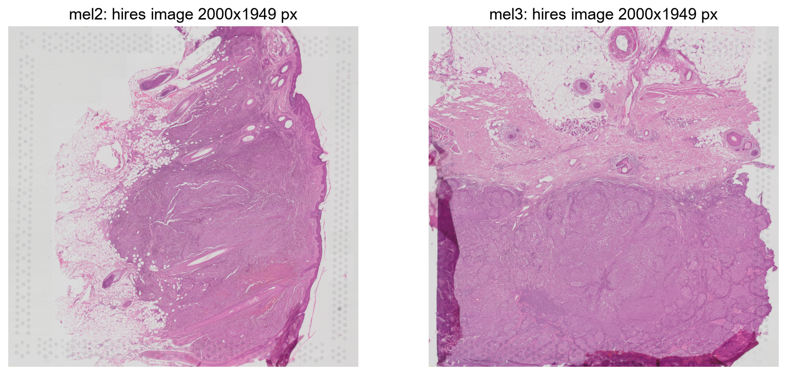
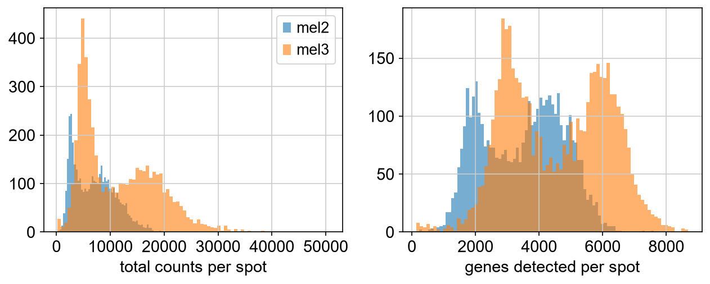
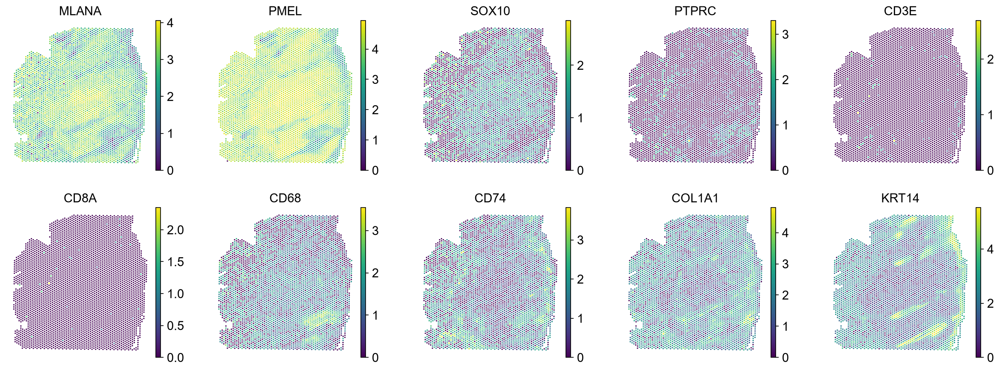
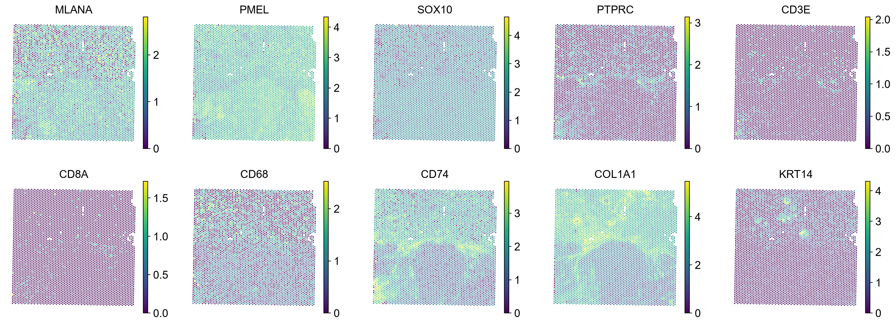
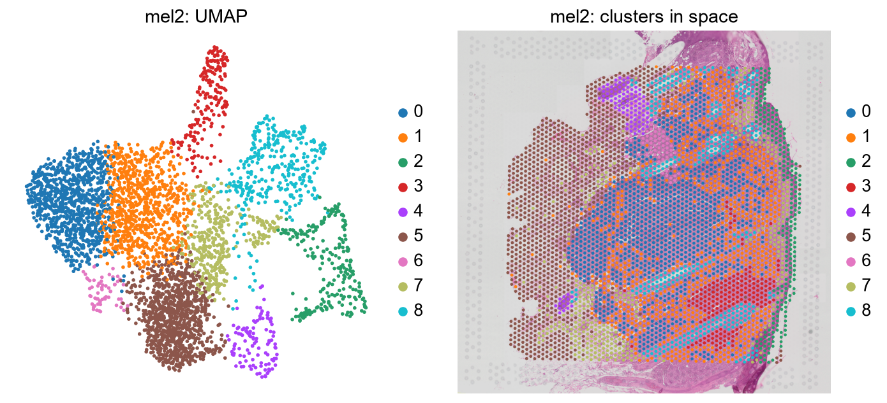
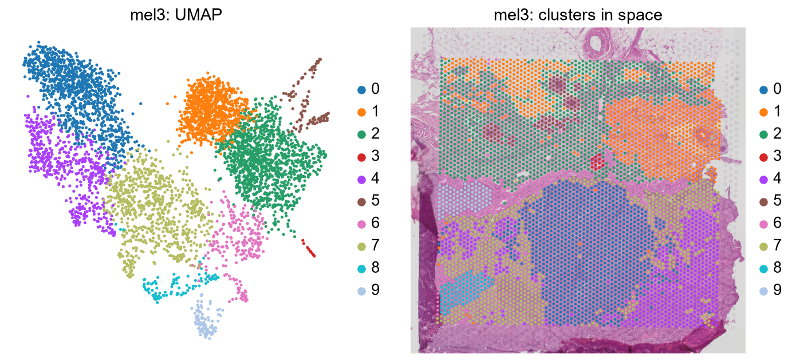

# 01 · GSE316760 – primary cutaneous melanoma (guide)

Companion to `../notebooks/01_explore_GSE316760.ipynb`. General concepts (Visium, AnnData, QC, clustering, marker
genes) are explained in [`00_concepts.md`](00_concepts.md).

## At a glance

| | |
|---|---|
| Study | "Spatial transcriptomics of primary cutaneous melanoma". No publication linked on GEO. |
| Samples | 2 primary melanomas: **mel2** (4,084 spots) and **mel3** (4,949 spots) |
| Protocol | Visium for FFPE, tissue placed directly on a Visium V1 slide; Space Ranger 2.0.1 |
| Capture area | 6.5 × 6.5 mm (4,992 spots) |
| Genes | 17,943 (FFPE probe set v1); **no mitochondrial genes** |
| Files | Standard Space Ranger `.h5` + positions + images: the cleanest dataset |
| Clinical / region labels | None |
| Role in the project | Simplest dataset; **mel3 is a clean test case** for "immune regions near tumour" |

## Why this dataset matters

It is the cleanest of the four: standard files, one tissue section per sample, and both sections contain tumour,
dermis and epidermis. It is where we built and tested the loading code and the unit checks used by all other
notebooks. Its barcode list also serves as the **reference grid** to recover spot positions in GSE221390
(guide 04).

## What we did and what we found (by notebook section)

### 1. Load the samples
`load_visium` rebuilds the folder layout Squidpy expects (in `data/processed/visium/GSE316760_mel2/` etc.) and
reads it with `squidpy.read.visium`. Nothing special was needed here.

### 2. What is inside the AnnData object
- mel2: 4,084 spots × 17,943 genes, 19% non-zero; mel3: 4,949 × 17,943, 25% non-zero.
- Raw integer counts (not normalised by the authors).
- `obs` only has `in_tissue`, `array_row`, `array_col`; `var` has Ensembl IDs.

### 3. Metadata
- Space Ranger 2.0.1, "Visium V1 Slide", reference GRCh38-2020-A.
- **No `MT-` genes in the panel**, so the usual "% mitochondrial" quality check is impossible here.
- All spots have `in_tissue == 1`: GEO provides the *filtered* matrix (spots under tissue only).

### 4. Tissue images

H&E images (hires 2000 px). Spots exist only inside the 6.5 mm capture area **and** under tissue. Tissue outside
the capture area (e.g. the top and bottom of mel2) was never measured: for the LLM, "no data" there must not be
read as "no cells".

### 5. Coordinate units
| | mel2 | mel3 |
|---|---|---|
| Neighbouring spots | 289 px | 289 px |
| µm per pixel (grid method) | **0.346** | **0.346** |
| `65 / spot_diameter_fullres` | 0.346 (agrees) | 0.346 (agrees) |
| `55 / spot_diameter_fullres` (wrong) | 0.293 (−15%) | 0.293 (−15%) |
| Tissue extent | 6.30 × 6.40 mm | 6.79 × 6.46 mm |

In this dataset (Space Ranger 2.0.1) both methods agree. In the other datasets they do not, which is why the
project uses the grid method everywhere (see `00_concepts.md` §5).

### 6. Quality control

| | median counts / spot | median genes / spot | min counts |
|---|---|---|---|
| mel2 | 6,690 | 3,630 | 269 |
| mel3 | 9,572 | 4,561 | 138 |

Good depth for FFPE. Spatial QC maps (`results/GSE316760/qc_spatial_*.png`) show lower counts towards loose,
fatty tissue at the edges, which is expected rather than a technical problem.

### 7. Marker genes

- **mel2:** melanocytic genes (`PMEL`, `MLANA`) are high across most of the section, so tumour fills most of it.
  `KRT14` marks the epidermis along the right edge and diagonal streaks (hair follicles). T-cell genes (`CD3E`,
  `CD8A`) are almost absent; `CD68`/`CD74` form small patches.
- **mel3:** a tumour nodule in the lower half (low `COL1A1`, the dome shape), dermis above it (high `COL1A1`).
  `CD74` and `PTPRC` concentrate **along the border between tumour and stroma**, plus a patch at the bottom left.

### 8. Clustering

Proposed interpretation from the top genes of each cluster (hypotheses, see `00_concepts.md`):

**mel2 (9 clusters)**

| Cluster | Top genes | Interpretation |
|---|---|---|
| 0, 1 | PMEL, MLANA, TYRP1, PAEP, MLPH, BIRC7 | Melanoma (differentiated, pigment genes) |
| 2 | KRT1, KRT10, KRTDAP, S100A8/9 | Upper epidermis |
| 3 | FTL, CTSD, LAPTM5, PSAP, CD68, TYROBP | Macrophage-rich patch |
| 4, 6 | KRT71, KRT25, KRTAP… | Hair follicles |
| 5 | FTL, SPP1, DCN, APOD, KRT14 | Mixed dermis at the left (fatty) margin |
| 7 | CD74, HLA-DRA, COL1A2, MMP2 | Stroma with antigen-presenting / immune cells |
| 8 | KRT14, KRT5, S100A2, KRT6B | Basal epidermis |

**mel3 (10 clusters)**

| Cluster | Top genes | Interpretation |
|---|---|---|
| 0 | MCAM, HMGA2, BCAN, NELL1, HSPA8 | Melanoma, possibly less differentiated |
| 4 | PMEL, MLPH, APOE, SPP1, CD63 | Melanoma, differentiated |
| 1 | IGKC, IGHG1, MYL9, ACTA2 | Plasma cells + vessels/smooth muscle |
| 2 | COL1A1, COL1A2, DCN, COL3A1 | Dermal fibroblasts |
| 3, 5 | S100A8/9, DSG1 / KRT14, KRT5, KRT15 | Epidermis (upper / basal) |
| 6 | CD74, HLA-DRA, IGKC, LYZ, IL32 | **Immune** (antigen presentation, macrophages, plasma and T cells) |
| 7 | HLA-E, HLA-C, B2M, TAP1 | Interferon / MHC-I programme (inflamed tissue) |
| 8 | MPZ, S100B | Nerve |
| 9 | APOD, ABCA8, SCRG1 | Fibroblast / adipose-like |

The two tumour clusters in mel3 (0 vs 4) may be two melanoma cell states (less vs more differentiated), a theme of
the GSE300445 paper. This is a hypothesis.

### 9. Saved files
`data/processed/GSE316760_mel2.h5ad` and `GSE316760_mel3.h5ad` (counts, normalised data, QC, µm coordinates,
clusters).

## Caveats

- No publication or clinical data: we do not know stage, treatment or outcome.
- Cluster names are our interpretation, not pathology annotations.
- Spots are mixtures of cells; "immune cluster" means "spots where immune signal dominates".

## Open questions
1. Validate the tumour / immune / stroma interpretation against the H&E.
2. mel3 is a good first test case for the spatial operations: define tumour and immune regions with marker scores
   and measure immune-to-tumour distances in µm.
