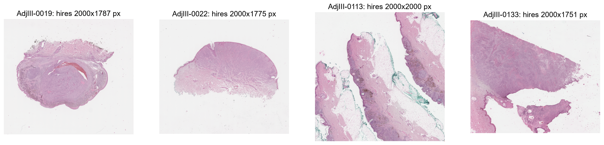
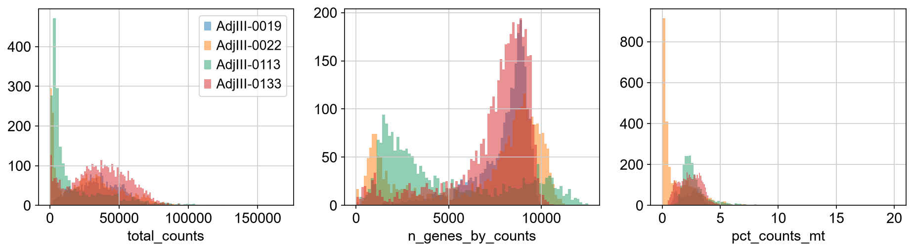
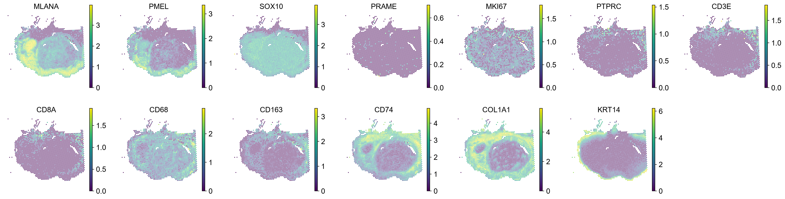
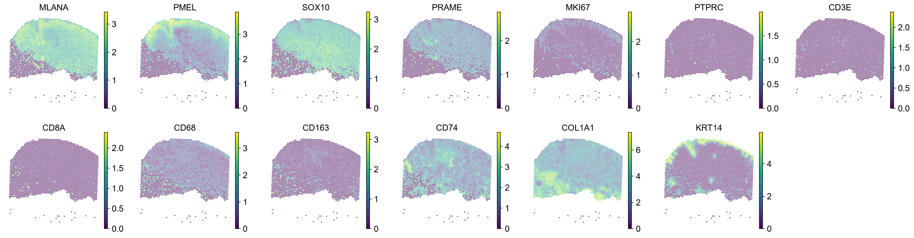
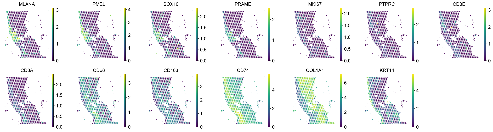
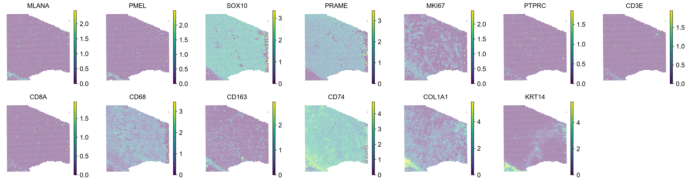
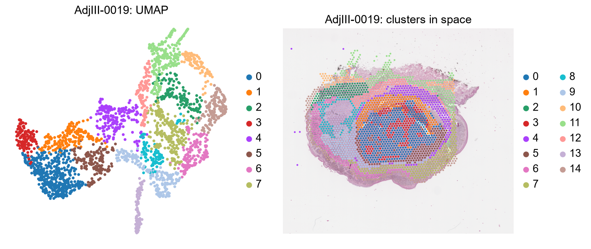

# 02 · GSE300445 – primary melanoma before anti-PD1 immunotherapy (guide)

Companion to `../notebooks/02_explore_GSE300445.ipynb`. General concepts are in [`00_concepts.md`](00_concepts.md);
this guide focuses on what is specific to this dataset and how it differs from GSE316760 ([guide 01](01_GSE316760.md)).

## At a glance

| | |
|---|---|
| Study | "Spatial tumour-immune ecosystems shape the efficacy of anti-PD1 immunotherapy in primary cutaneous melanoma" ([PMID 42315253](https://pubmed.ncbi.nlm.nih.gov/42315253/)). The Visium part of a larger study (bulk RNA-seq of 57 patients, snRNA-seq). |
| Samples | 4 stage III patients: **AdjIII-0019, -0022, -0113, -0133** (2,145–4,115 spots each) |
| Protocol | **CytAssist** (probes transferred from a glass slide), Space Ranger **3.0.0** |
| Capture area | 6.5 × 6.5 mm, chosen by the authors inside a larger H&E section |
| Genes | 18,085 (probe set v2), **including 11 mitochondrial genes** |
| Files | `.mtx` + barcodes + features, with an extra `_processed` in the file names |
| Clinical / region labels | None on GEO; **response to therapy is only in the paper** |
| Role in the project | Directly about immune cells around melanoma; samples range from immune-poor to immune-rich |

## Why this dataset matters

The paper's question is close to ours: melanoma cells organise into spatial patches of different **cell states**
(differentiated vs undifferentiated), and the **immune cells around them** (especially macrophages, IFN-γ and
hypoxia signalling) relate to how well anti-PD1 works. The four samples are very different from each other, which
is useful for testing whether the LLM's spatial answers change correctly between tissues.

## Differences from GSE316760

| | GSE316760 | GSE300445 |
|---|---|---|
| Protocol | Tissue directly on the Visium slide | CytAssist: tissue on a normal slide, probes transferred |
| Space Ranger | 2.0.1 | 3.0.0 |
| Gene panel | 17,943 (v1), no `MT-` | 18,085 (v2), 11 `MT-` genes → % mitochondrial QC possible |
| Matrix format | `.h5` (stores chemistry/version) | `.mtx` (metadata must come from GEO's series matrix) |
| Image | photo of the Visium slide | scan of the original glass slide; the capture area covers only part of it |
| `spot_diameter_fullres` rule | correct with 65 µm | **wrong by exactly 7.14%** (corresponds to 70 µm) |

## What we did and what we found (by notebook section)

### 1. Load the samples
Same `load_visium` as notebook 01, with prefixes like `GSM9060732_AdjIII-0019_processed`.
**GEO typo:** the sample list says "ADJIII-0013", but its files (GSM9060734) say "AdjIII-0113". We follow the files.

### 2. What is inside
| Sample | Spots | Non-zero |
|---|---|---|
| AdjIII-0019 | 2,539 | 44% |
| AdjIII-0022 | 2,783 | 38% |
| AdjIII-0113 | 2,145 | 27% |
| AdjIII-0133 | 4,115 | 41% |

Integer counts; `var` has no `genome` column (the `.mtx` format does not store it).

### 3. Metadata
From GEO's series matrix: 5 µm FFPE sections, H&E-stained at the CRCL pathology platform (Lyon); a 6.5 × 6.5 mm area
chosen per patient; CytAssist; Space Ranger 3.0.0 with the probe set v2 (GRCh38-2020-A); target 50,000 reads/spot.
The 11 `MT-` genes are MT-ND1…6, MT-CO2/3, MT-ATP6, MT-ND4L, MT-CYB.

### 4. Tissue images

With CytAssist the image is the whole glass slide, so the spots cover only the chosen 6.5 mm window (clearly visible
in AdjIII-0133 and AdjIII-0113, where tissue continues outside the spots).

### 5. Coordinate units

| Sample | µm/px (grid, used) | 65 µm rule | error |
|---|---|---|---|
| AdjIII-0019 | 0.229 | 0.213 | −7.14% |
| AdjIII-0022 | 0.245 | 0.228 | −7.14% |
| AdjIII-0113 | 0.248 | 0.230 | −7.14% |
| AdjIII-0133 | 0.252 | 0.234 | −7.14% |

The error is **identical in every sample** (−1/14): Space Ranger 3.0 defines `spot_diameter_fullres` as a 70 µm
spot instead of 65 µm. This is the clearest evidence that the scale-factor rule cannot be trusted across versions,
and why the project always uses the grid. Pixel size also differs between samples, so all distances must be in µm.

### 6. Quality control

| Sample | median counts | median genes | median % MT |
|---|---|---|---|
| AdjIII-0019 | 34,317 | 8,415 | 2.5 |
| AdjIII-0022 | 27,027 | 8,272 | 0.6 |
| AdjIII-0113 | **6,742** | **3,538** | 2.5 |
| AdjIII-0133 | 36,873 | 8,081 | 2.4 |

Very deep data (≈4–5× GSE316760) except **AdjIII-0113, which has ~5× fewer counts**; its results are noisier.
% mitochondrial is low everywhere (good quality); a few small clusters are dominated by `MT-` genes (0022 cluster 9,
0133 clusters 5 and 9), which usually means damaged or low-quality spots.

### 7. Marker genes

| Sample | Tumour | Melanoma state | Immune |
|---|---|---|---|
| **AdjIII-0019** | Large round nodule, `SOX10`+ throughout | **Zoned:** `MLANA`/`PMEL` high only on the left and at the rim; the core is `SOX10`+ but `MLANA`/`PMEL`-low (dedifferentiated). `PRAME` very low (PRAME-negative melanoma). | Little: `CD74`/`CD68` in a stromal ring around the nodule, few T cells |
| **AdjIII-0022** | Dome-shaped tumour in the upper part | Mostly differentiated (`MLANA`, `PMEL`, `SOX10` high), moderate `PRAME` | Little: `CD74` patches, very few T cells |
| **AdjIII-0113** | Thin strip on the left side only | Differentiated, `PRAME`+ | **Most immune-rich:** `PTPRC`, `CD3E`, `CD8A`, `CD68`, `CD163`, `CD74` all clearly present in the stroma next to the tumour |
| **AdjIII-0133** | Fills almost the whole window | **Dedifferentiated:** `SOX10`+ and `PRAME` high, but `MLANA`/`PMEL` absent | `CD74` high broadly and `CD68` moderate (macrophage/inflammation), few T cells |

### 8. Clustering

Main interpretations (top genes in the notebook; hypotheses):

- **AdjIII-0019 (15 clusters): clear concentric organisation.** Core: cluster 0 (DCBLD2, ITGB8, undifferentiated
  melanoma) with scattered cluster 3 (**hypoxia**: VEGFA, ENO1/2, P4HA1, ERO1A). Ring: cluster 1 (SERPINA3, CHI3L1,
  TIMP1, MIA) and cluster 4 (vessels: COL4A1/2, PLVAP, RGS5). Differentiated melanoma on the left/rim: clusters 6, 7
  (TYR, PMEL, GPR143) and 9 (BCAN, MLANA). Outside: stroma (2, 8, 12: POSTN, VCAN, MMP11), nerve (5: MPZ, S100B),
  epidermis (10, 14). This matches the paper's idea of **spatially restricted melanoma cell states**.
- **AdjIII-0022 (12 clusters):** several melanoma clusters (1: GPNMB, CSPG4; 3: MYC, CD44; 4: interferon genes IFI27,
  IFI6 with TYR; 7: TYR, EDNRB, TFAP2B), fibroblasts (0, 5), vessels with CD74 (2), epidermis (6), smooth muscle (8),
  a high-`MT-` cluster (9) and a tiny noisy one (11, 17 spots).
- **AdjIII-0113 (12 clusters):** mostly skin and stroma: adipose/vessels (0), fibroblasts (1, 4), sweat glands (2),
  epidermis (6, 7, 11), smooth muscle (10), **lymphatic vessels** (5: CCL21, LYVE1, PROX1), melanoma (8: MLANA, TYR,
  PRAME) and two **immune clusters**: 3 (CCL19, CD74, IRF8: lymphoid/dendritic-cell area) and 9 (LYZ, CD74, CCL5,
  NKG7: macrophages plus cytotoxic cells).
- **AdjIII-0133 (10 clusters):** tumour states dominate: **hypoxic** tumour (0: NDRG1, SLC2A1, BNIP3L), mesenchymal-like
  (1: VIM, IL13RA2, TIMP1), others (2, 3: MIA, APOD), CD74-high tumour/immune (4), plasma cells/epidermis (6).
  ⚠️ **Cluster 7 forms a straight vertical stripe at the right edge** of the capture area with keratinocyte and
  inflammatory genes (S100A8/9, KRT6A/16/17) inside an area that looks like tumour on H&E. This looks like a
  **technical edge artefact**; exclude or check it before spatial analyses.

### 9. Saved files
`data/processed/GSE300445_AdjIII-*.h5ad` (gzip-compressed, 65–143 MB each).

## Caveats

- No response-to-therapy labels on GEO; to link spatial patterns with anti-PD1 efficacy we need the paper's
  supplementary tables.
- AdjIII-0113 has low counts; AdjIII-0133 has a probable edge artefact (cluster 7).
- The capture windows were chosen by the authors, so they show only part of each tumour.

## Open questions

1. Which patients responded to anti-PD1? (paper supplement)
2. Is AdjIII-0133's cluster 7 an artefact? Check its spots on the H&E.
3. AdjIII-0113 (immune-rich, tumour at the edge) and AdjIII-0019 (immune-poor, zoned tumour) are good contrasting
   cases for "how far are immune-enriched regions from the tumour?".
