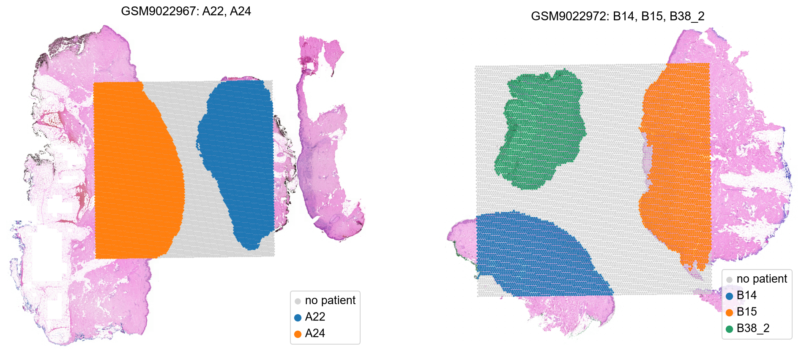
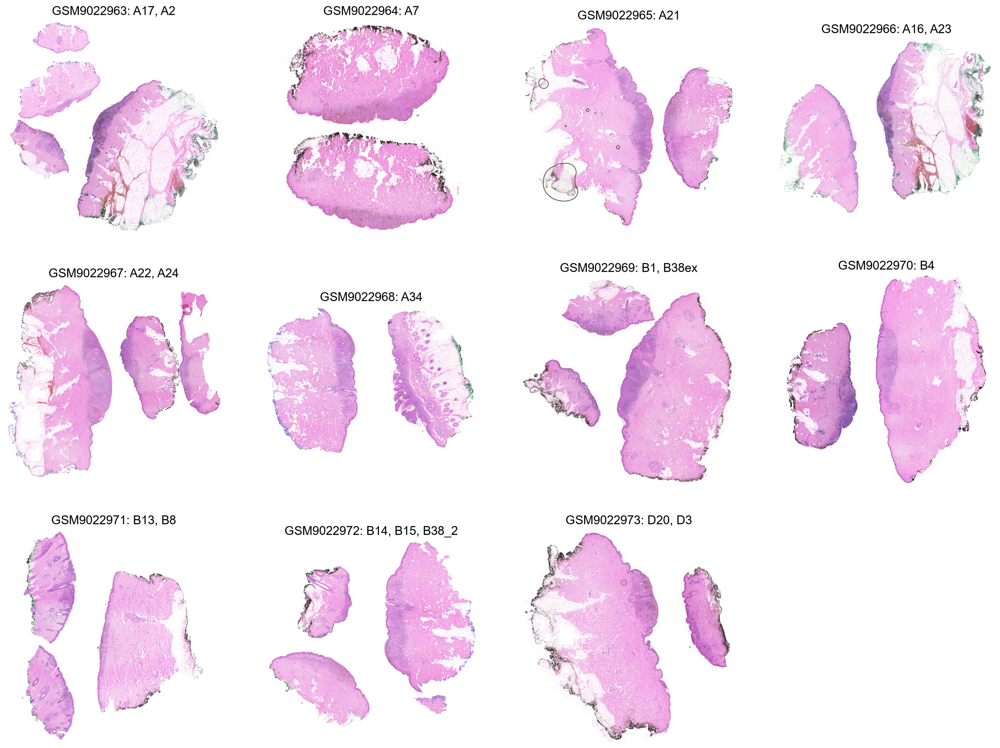
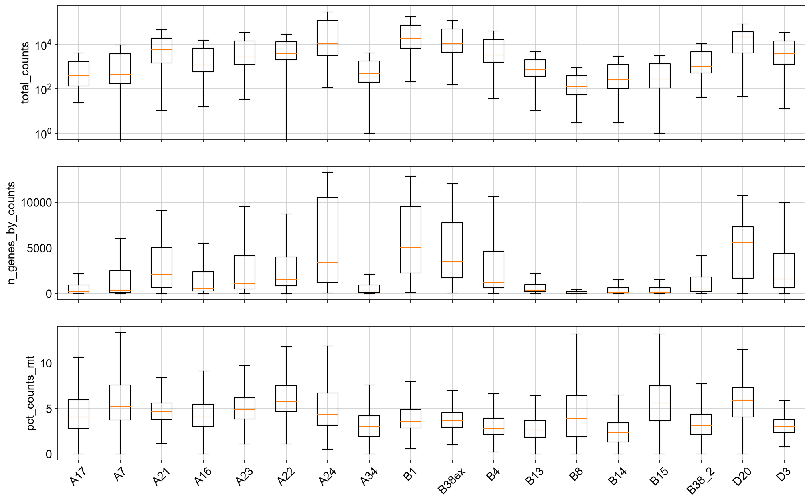
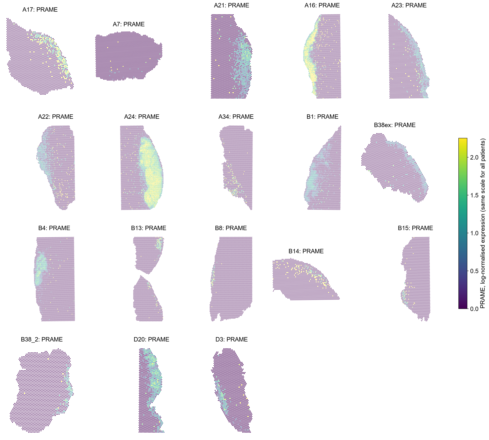
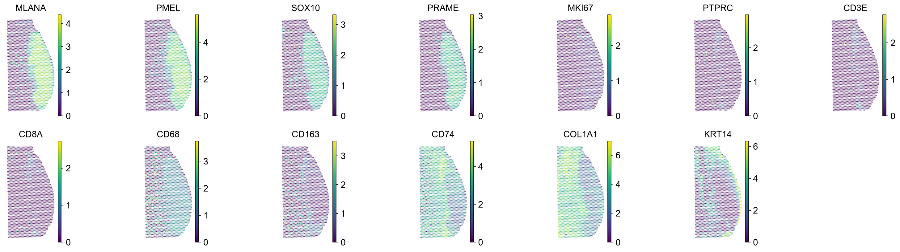
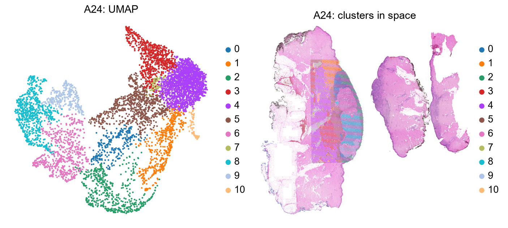

# 03 · GSE298774 – nevus → melanoma transition (guide)

Companion to `../notebooks/03_explore_GSE298774.ipynb`. General concepts are in [`00_concepts.md`](00_concepts.md).
This is the largest and most complex dataset; read sections 1–3 carefully, because the files do not map one-to-one
to patients.

## At a glance

| | |
|---|---|
| Study | "Spatial gene expression and microenvironmental changes in the transition of nevus to melanoma" ([PMID 42258703](https://pubmed.ncbi.nlm.nih.gov/42258703/)). Visium plus imaging mass cytometry (IMC, not on GEO). |
| Design | Lesions where a **benign nevus and a melanoma sit next to each other in the same section** |
| Samples | 11 GEO samples = 11 capture areas holding **19 patients' lesions; 18 usable** (A2 has no barcodes) |
| Protocol | CytAssist, Space Ranger 2.1.1 |
| Capture areas | mostly 11 × 11 mm (14,336 spots); A7, A21, D3, D20 on 6.5 mm |
| Genes | 37,082 (15 patients) or 18,085 (A16, A21, A23), both with mitochondrial genes |
| Quality | **Extremely variable** between patients |
| Clinical / region labels | None: which spots are nevus and which are melanoma is not given |
| Role in the project | Built-in tumour vs non-tumour comparison inside each tissue; several lesions with clear immune infiltrates |

## Why this dataset matters

Every lesion contains a benign part (nevus) and a malignant part (melanoma). Both are melanocytic, so `MLANA`/`PMEL`
are high in both; `PRAME` is the classic marker that is high in melanoma and low in nevi. This gives a natural
"tumour region vs non-tumour region" contrast within one tissue, and several lesions (especially A24) have strong
immune activity next to the tumour.

## Differences from GSE316760

| | GSE316760 | GSE298774 |
|---|---|---|
| One GEO sample = | one tissue section | **one capture area shared by 1–3 patients** |
| Matrix | only spots under tissue | **often the whole capture area**; each patient's `tissue_positions.csv` marks its spots |
| Panels | 17,943 genes, no `MT-` | **37,082 or 18,085**, with `MT-` genes |
| Quality | homogeneous, good | **from very shallow to very deep** |
| Units | 65 µm rule works | **65 µm rule off by ~7–8%, sign depends on capture-area size** |
| Problems | none | A2 unusable; GEO says the data are filtered but the 500-gene filter was not applied |

## What we did and what we found (by notebook section)

### 1. How the files map to patients
GEO titles read like *"Nevus and melanoma in a single slide of patient A22 and A24"*: several patients' sections were
placed on one capture area and sequenced together. The authors then split the files per patient
(`GSM9022967_A22_…`, `GSM9022967_A24_…`).

- Each patient's `tissue_positions.csv` lists **all** spots of the capture area; `in_tissue == 1` marks only that
  patient's spots. The masks of patients on the same area **never overlap**.
- For most shared areas the **count matrix is the same whole-area matrix** for every patient. To get one patient we
  load it and keep its own spots: `load_visium(..., in_tissue_only=True)`.
- **A2 is excluded:** it has no `barcodes.tsv.gz`, and its matrix has 13,916 unnamed columns that do not match A17's
  13,887 barcodes, so its columns cannot be assigned to spots.

### 2. A shared capture area, visualised

Left: A24 (orange) and A22 (blue) are two separate pieces of tissue on one 11 mm capture area; grey spots belong to
neither. Right: three patients (B14, B15, B38_2) on one area. The H&E image is the whole glass slide, larger than the
capture area.

### 3. Load all patients
18 AnnData objects, one per patient (~1,100 to ~6,400 spots each).

### 4. What is inside, and metadata
- 15 patients with 37,082 genes (13 `MT-` genes), 3 patients (A16, A21, A23) with 18,085 genes (11 `MT-`).
  To compare all patients we will need to keep the ~18k shared genes. The big panel includes some genes named
  `DEPRECATED_ENSG…` (retired gene IDs), harmless.
- GEO: Space Ranger 2.1.1, CytAssist image + H&E image, then "spots with more than 500 genes and less than 30%
  mitochondrial counts were retained" with the R package *semla*. Section 7 shows this is only partly true of the
  files.

### 5. Tissue images

One image per capture area (shared by its patients).

### 6. Coordinate units

| Capture area | µm/px (grid) | 65 µm rule error |
|---|---|---|
| 6.5 mm (A7, A21, D3, D20) | 0.22–0.29 | **−7.1 to −7.2%** |
| 11 mm (all others) | 0.28–0.39 | **+7.6 to +7.9%** |

The scale-factor rule fails in **opposite directions** depending on the capture-area size, while the grid method is
consistent. Patients sharing a capture area share the same pixel size. Several lesions span ~11 mm.

### 7. Quality control

| Patient | median counts | median genes | Patient | median counts | median genes |
|---|---|---|---|---|---|
| D20 | 21,899 | 5,637 | A16 | 1,246 | 554 |
| B1 | 19,685 | 5,075 | B38_2 | 1,085 | 533 |
| B38ex | 11,309 | 3,469 | B13 | 752 | 402 |
| A24 | 11,291 | 3,400 | A34 | 507 | 300 |
| A21 | 5,915 | 2,129 | A7 | 460 | 378 |
| A22 | 4,010 | 1,546 | A17 | 410 | 244 |
| D3 | 3,846 | 1,622 | B15 | 288 | 151 |
| B4 | 3,374 | 1,199 | B14 | 265 | 147 |
| A23 | 2,812 | 1,099 | B8 | **128** | **70** |

- Depth varies **~170-fold** between patients. B8, B14, B15, A17, A7 and A34 are very shallow: their maps and
  clusters will be noisy, and they may need to be excluded.
- **The files are only partly filtered as GEO says.** The mitochondrial threshold holds (practically no spot has
  ≥ 30% MT; only 0.1% in B8), and spots with 0 counts are extremely rare. But the **500-gene threshold was not
  applied**: spots with ≤ 500 genes make up 85% of B8, 58–70% of A17, A34, B13, B14 and B15, 47–55% of A7, A16 and
  B38_2, and under 6% of A22, A24, B1, B38ex and D20. We need our own QC filter before spatial analyses.

### 8. Marker genes

`PRAME` and `MLANA` are plotted for all patients **on the same colour scale**, so patients can be compared.

- **Strong, coherent PRAME+ regions:** A24 (a large region) and A16 (a band along one edge).
- **Moderate PRAME+ regions:** A21, A22, B1, B4, D20, D3, and the rim of A17.
- **Little or none:** A7, A34, B8, B13, B14, B15. These are mostly the shallow patients (section 7), so the absence
  may be technical rather than biological. Isolated bright spots in shallow patients are noise (a spot with very
  few counts gets inflated values after normalisation).

Interpretation: a PRAME+ region is a candidate **melanoma part**; a melanocytic (MLANA+) but PRAME-negative region is
a candidate **nevus part**. This is a first, rough split that must be checked against the paper's annotations.

**A24 (example):** a tumour region on the right (`MLANA`, `PMEL`, `SOX10`, `PRAME` all high), stroma on the left
(`COL1A1`), epidermis along the right edge (`KRT14`), and `CD74` concentrated along the tumour border.

### 9. Clustering (four example patients)

**A24 (11 clusters): the best tumour–immune example in the dataset**

| Cluster | Top genes | Interpretation |
|---|---|---|
| 0 | CXCL9, CXCL10, STAT1, GBP1/5, UBD, B2M | **IFN-γ response / T-cell inflamed region** (265 spots) |
| 5 | IGHG1, IGKC, IGLC2/3 | Plasma cells (761 spots) |
| 6 | S100A1, MCAM, CAPN3, CNIH3 | Melanocytic |
| 8 | PMEL, TYR, PAEP, NSG1 | Differentiated melanoma |
| 9 | SPP1, CXCL8, IFI6, TYRP1, DCT | Melanocytic with inflammatory signal (SPP1+ macrophages?) |
| 1, 2, 10 | KRT1/10/14, S100A7/8/9, KRT16 | Epidermis (2: inflamed / hyperproliferative) |
| 3 | DCD, MUCL1, SCGB2A2 | Sweat glands |
| 4 | DCN, COL1A1, MMP2 | Fibroblasts (largest) |
| 7 | IGFBP7, TAGLN, ACTA2, NOTCH3 | Vessels / smooth muscle |

**A22 (11 clusters):** mostly normal skin: dermis (0, 6), sweat glands (2, 4), adipose/blood (3), sebaceous (5),
epidermis (8, 10), two melanocytic clusters (7: CSPG4, SERPINE2, ETV5; 9: EDNRB, CD74, VIM) and a high-`MT-`
low-quality cluster (1).

**B4 (12 clusters):** fibroblasts (0, 1, 4, 10), vessels (2), sweat glands (3), epidermis (6, 9), sebaceous (8),
adipose (11) and **two melanocytic clusters**: 5 (MLANA, DCT, PAX3, CRTAC1) and 7 (PMEL, MIA, TNC, BCL2A1, B2M).
Two melanocytic populations within one lesion are candidates for the nevus and the melanoma part.

**A16 (11 clusters, 18k panel):** three melanocytic clusters, 0 (TYRP1, PMEL, MLANA, ABCB5), 5 (ETV1, PTPRZ1, RXRG,
PLP1: a neural-crest-like state) and 10 (DCT, MLANA, SNAI2), plus immune (7: LYZ, CD74, CCL19), fibroblasts (2, 8),
smooth muscle (4), sweat glands (6), epidermis (3), adipose/blood (1, 9).

### 10. Saved files
`data/processed/GSE298774_<patient>.h5ad` for the 18 usable patients (gzip-compressed; counts, normalised data, QC,
µm coordinates; clusters only for A22, A24, B4, A16).

## Caveats

- No nevus / melanoma labels: `PRAME` and cluster differences are hypotheses until checked against the paper's
  annotations or H&E.
- Very uneven quality; filter spots and consider excluding the shallowest patients.
- Two gene panels: restrict to shared genes when comparing patients.
- The IMC data (protein-level cell types) from the paper are not on GEO.

## Open questions

1. Can we get the authors' nevus / melanoma annotations (paper supplement, or ask them / Myles)?
2. Can A2's barcodes be recovered from the authors?
3. Which QC thresholds and which patients to keep for the spatial-operation stage?
4. A24 (inflamed tumour border) and D20 / B1 (deep data) look like the best candidates for the first spatial
   questions.
