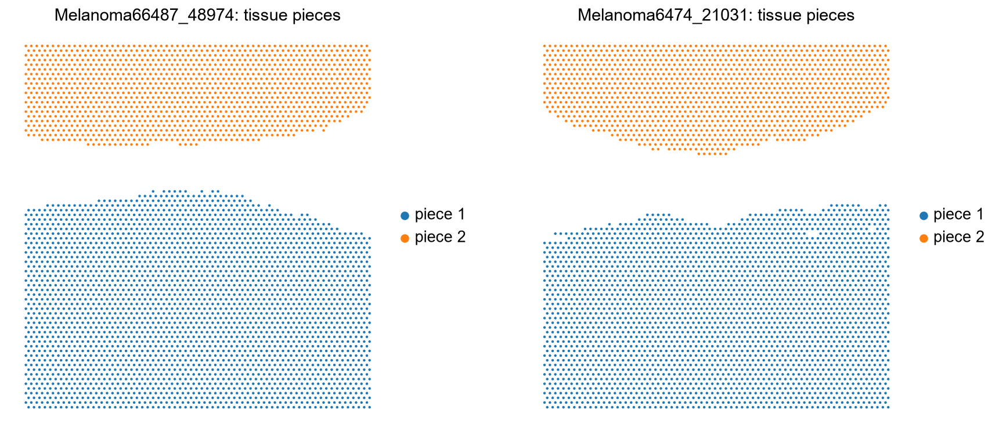
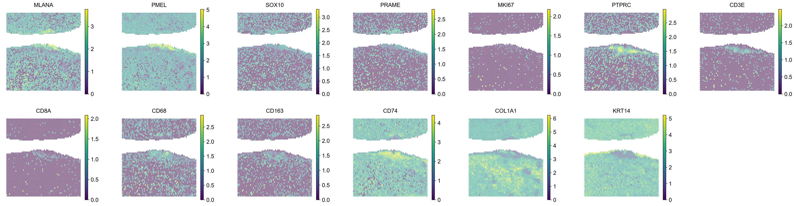
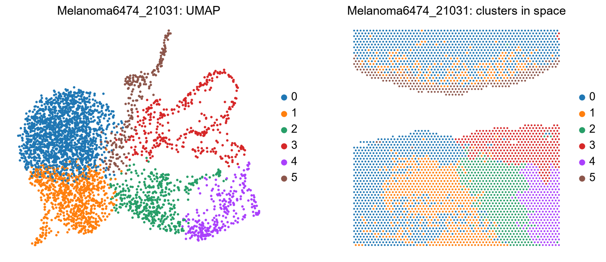

# 04 · GSE221390 – skin cancer atlas, melanoma Visium samples (guide)

Companion to `../notebooks/04_explore_GSE221390.ipynb`. General concepts are in [`00_concepts.md`](00_concepts.md).
This dataset is the most unusual of the four: **GEO has no images and no spot positions**, and we had to recover
them.

## At a glance

| | |
|---|---|
| Study | "Comparative skin cancer atlas and interactome" (University of Queensland): SCC, BCC and melanoma profiled with six spatial / single-cell technologies. No PubMed ID on GEO. |
| Samples used | The **2 melanoma Visium samples**, each with sections from **two patients**: Melanoma66487_48974 (4,093 spots) and Melanoma6474_21031 (3,901 spots) |
| Not used | 3 SCC and 2 BCC Visium samples, and a single-cell RNA-seq dataset (SCC/BCC/healthy skin, no melanoma) |
| Protocol | Visium for FFPE on a V1 slide (same as GSE316760); FFPE blocks from 2008–2018 |
| Genes | 17,943 (FFPE probe set v1, **identical to GSE316760**), no mitochondrial genes |
| Files | **Only the count matrix** (`filtered_feature_bc_matrix.tar.gz`): no images, positions or scale factors |
| Clinical / region labels | None |
| Role in the project | Limited: positions recovered without an image, and the sections contain little tumour |

## Differences from GSE316760

| | GSE316760 | GSE221390 |
|---|---|---|
| Files | matrix + images + positions | **matrix only** |
| Coordinates | pixels, converted to µm | **recovered from barcodes, directly in µm, orientation unknown** |
| Image | H&E | **none**, so nothing to check the tissue against |
| Patients per sample | 1 | **2**, separated by tissue piece; which piece is which patient is unknown |
| Depth | median 6,700–9,600 counts/spot | **median 1,300–4,300** (shallower) |
| Tissue content | tumour fills most of the section | **mostly normal skin structures, small melanocytic areas** |

## What we did and what we found (by notebook section)

### 1. What GEO gives us
Each sample's `.tar.gz` contains only `matrix.mtx.gz`, `barcodes.tsv.gz` and `features.tsv.gz`. Without positions
this would be "bulk-like" data with no space.

### 2. Recovering the spot positions
Every Visium slide of the same version assigns **each barcode to the same grid position**. GSE316760 used the same
slide version and its `tissue_positions.csv` lists all 4,992 barcodes with `array_row`/`array_col`.

- **All 4,093 and 3,901 barcodes** of the two samples are in that reference list (for comparison, CytAssist
  barcodes from GSE300445 share 0 of 4,992, so the match is not a coincidence).
- `load_visium_without_images` adds `array_row`/`array_col` and converts them to µm with the physical grid
  (one column step = 50 µm, one row step = 86.6 µm).
- **Caveat:** without the image we do not know the slide's orientation under the microscope; the layout may be
  mirrored or rotated. **Distances are correct; directions ("top", "left") are not meaningful.**

### 3. What is inside, and metadata
- 17,943 genes, raw integer counts; 17% (66487_48974) and 8.5% (6474_21031) non-zero, i.e. sparse, shallow data.
- `obsm["spatial"]` is already in µm; `uns["spatial"]` has no images or scale factors.
- GEO metadata is generic ("skin", "multiple cell types"). The protocol text names the four melanoma patients
  (6747-085P, 21031-08TB, 48974-2B, 66487-1A). **GEO inconsistency:** "6474" in the sample title vs "6747" in the
  protocol.

### 4. Separating the two patients

Linking spots whose centres are ≤ 100 µm apart and taking the connected groups gives **exactly two pieces per
sample** (2,798 + 1,295 and 2,622 + 1,279 spots), one per patient. We call them *piece 1* (larger) and *piece 2*,
stored in `obs["piece"]`. **Treat each piece as a separate patient** in later analyses.

### 5. Coordinate units
Coordinates come straight from the grid, so they are µm by construction: the median neighbour distance is exactly
100 µm, and each sample spans 6.35 × 6.67 mm (the whole 6.5 mm capture area is covered by tissue).

### 6. Quality control

| Sample | Piece | median counts | median genes |
|---|---|---|---|
| Melanoma66487_48974 | 1 | 3,018 | 2,143 |
| | 2 | 4,347 | 2,859 |
| Melanoma6474_21031 | 1 | 1,777 | 1,284 |
| | 2 | 1,259 | 947 |

Shallower than GSE316760, especially Melanoma6474_21031. No `MT-` genes, so no mitochondrial QC.

### 7. Marker genes

- **Melanoma66487_48974:** a **band along one border of piece 1** with high `MLANA`/`PMEL` together with `PTPRC`,
  `CD3E` and `CD74`, i.e. melanocytic cells with an immune infiltrate next to the epidermis (`KRT14`). The rest is
  dermis (`COL1A1`) and skin structures.
- **Melanoma6474_21031:** melanocytic signal is limited to a band (cluster 5, below); most of the tissue is epidermis,
  dermis, hair follicles and sebaceous glands.
- `PRAME` and `MKI67` are low overall.

### 8. Clustering

**Melanoma66487_48974 (8 clusters)**

| Cluster | Top genes | Interpretation |
|---|---|---|
| 0 | KRT10, KRT1, KRT2, FLG, LOR | Upper epidermis |
| 1 | PM20D1, C1R, FADS2, KRT79, DCN | Sebaceous gland / dermis mix |
| 2 | FADS2, KRT79, FASN, APOC1 | Sebaceous gland (34 spots) |
| 3 | COL1A1, COL1A2, COL3A1, SPARC, DCN | Dermal fibroblasts (largest cluster) |
| 4 | MYL9, ACTA2, TAGLN | Smooth muscle / vessels |
| 5 | DCD, SCGB1D2, MUCL1, PIP | Sweat glands |
| 6 | B2M, HLA-C, LYZ, CD74, CCL5, HLA-DRA | **Immune** (macrophages, antigen presentation, T/NK cells) |
| 7 | TYRP1, TRPM1, IFI27, WNT4 | **Melanocytic / melanoma** (148 spots) |

**Melanoma6474_21031 (6 clusters)**

| Cluster | Top genes | Interpretation |
|---|---|---|
| 0 | KRT10, LOR, S100A8/9, KRT1, FLG | Epidermis (with inflammation genes S100A8/9) |
| 1 | VIM, SPARC, FN1, COL3A1 | Dermal fibroblasts |
| 2, 4 | KRTAP1-5, KRTAP3-2, KRT34 | Hair follicles |
| 3 | KRT79, MVD, SRD5A1, DHCR24 | Sebaceous glands |
| 5 | PMEL, TYRP1, TRPM1, NSG1 | **Melanocytic / melanoma** (230 spots) |

**Check that the recovered positions are right:** the clusters were computed from expression only, without
positions. If the recovered positions were wrong, neighbouring spots would share a cluster only by chance.

| Sample | touching spot pairs | same cluster (observed) | same cluster (positions shuffled 100×) |
|---|---|---|---|
| Melanoma66487_48974 | 11,893 | **81.5%** | 26.4% on average, never above 27.5% |
| Melanoma6474_21031 | 11,307 | **79.4%** | 27.0% on average |

Neighbours are three times more similar than chance, so the recovered grid preserves the real tissue structure.

### 9. Saved files
`data/processed/GSE221390_Melanoma66487_48974.h5ad` and `GSE221390_Melanoma6474_21031.h5ad` (both pieces together;
`obs["piece"]` says which is which).

## Caveats

- **No image**: interpretations cannot be checked against H&E, and orientation is unknown.
- Which piece belongs to which patient ID is unknown.
- **Little tumour**: only ~150–230 melanocytic spots per sample, so this dataset is weak for tumour–immune distance
  questions. It may be more useful as an example of "normal skin structures" or for checking that the LLM does not
  over-interpret absent tumour.
- Shallow data, especially Melanoma6474_21031.

## Open questions

1. Do the authors share images / `tissue_positions.csv` elsewhere (paper supplement, a data portal)? Ask Myles.
2. Are the two melanoma samples primary tumours, and what stage? (paper)
3. The single-cell data are SCC/BCC only, so they cannot serve as a melanoma reference.
