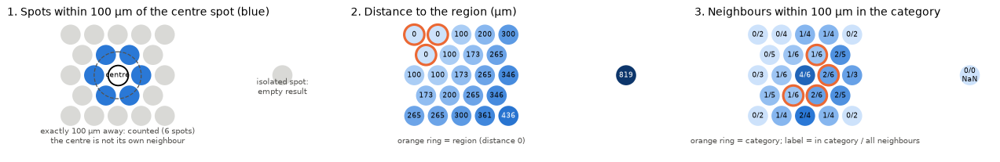
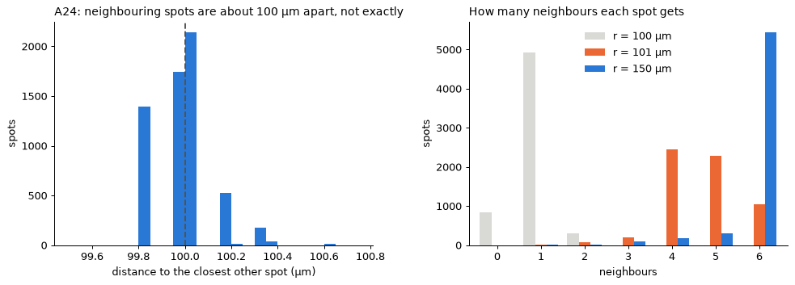
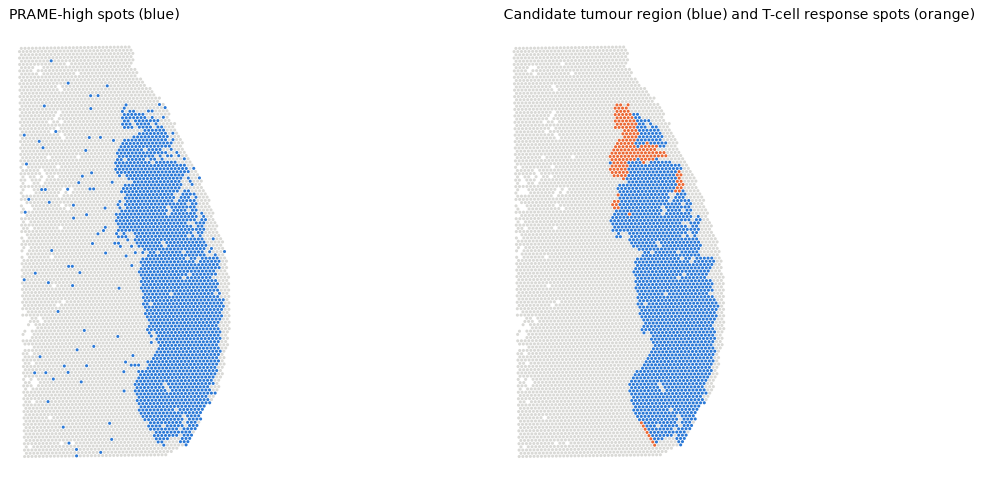
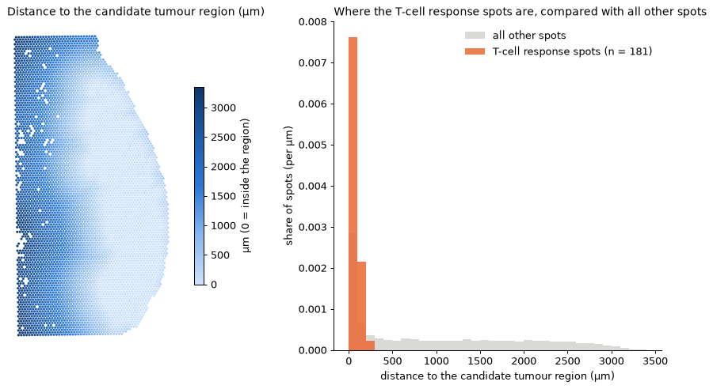
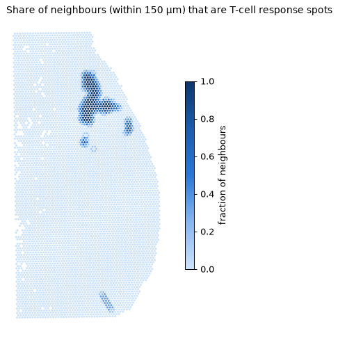
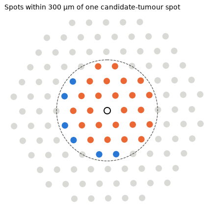

# Stage 2 · Spatial operations

The first three spatial operations of the project: what they do, the rules
they follow, how they are tested, and one real example on patient A24.

| Where | What |
|---|---|
| `src/space_mel/operations.py` | the three operations (reusable code, used by later stages) |
| `tests/test_operations.py` | 21 tests on tiny drawn examples with known answers |
| `02_spatial_operations/notebooks/01_spatial_operations.ipynb` | figures explaining the operations + the A24 example |
| `02_spatial_operations/results/` | the figures shown below |

Run the tests from the `spatial-reasoning` folder: `.venv\Scripts\python.exe -m pytest` (all 21 pass).

## The three operations

Every spot has a position in µm (`obsm["spatial_um"]`). Spot centres are about 100 µm apart.

| Operation | Question | Output |
|---|---|---|
| `spots_within_radius(spots, spot, r)` | which spots are within *r* µm of this spot? | list of spots |
| `distance_to_region(spots, in_region)` | how far is each spot from the nearest spot of a region? | distance (µm) per spot |
| `neighbourhood_fraction(spots, in_category, r)` | around each spot, what share of its neighbours are in a category? | neighbours, how many in the category, fraction |

`spots` is a small table made with `spots_table(adata)`: one row per spot with `x_um`, `y_um` and `section`. A
region or category is just a True/False value per spot, so it can come from anything (a gene threshold, a cluster,
a future pathologist annotation).

## The rules

1. **The boundary counts:** a spot exactly *r* µm away is within *r* µm.
2. **A spot is not its own neighbour.** A spot inside a region is at distance 0 from it.
3. **No neighbours:** empty list, and the fraction is NaN ("0 of 0" is undefined, not 0%).
4. **No region in a section:** the distance is NaN for that section, not a huge number.
5. **Sections never connect:** spots of different tissue sections (e.g. A22 and A24 on one capture area) are never
   neighbours, and distances are only measured inside the same section.

1. With *r* = 100 µm the centre spot gets its **6 touching spots** (exactly 100 µm away, so they count); the
   centre is not in its own list; the isolated spot gets an empty list.
2. Each number is the distance to the **nearest** orange spot; inside the region it is 0.
3. Each label is "neighbours in the category / all neighbours". An orange spot does not count itself; the
   isolated spot has 0/0, so its fraction is NaN.

## How they are tested

The tests build tiny fake examples where the right answer can be worked out by hand (for example five spots on a
line, 100 µm apart) and check the functions give exactly that answer. They cover:

- **simple known answers**: neighbours on a line, a 3-4-5 triangle distance (500 µm), fractions like 1/2;
- **boundary distance**: a spot exactly at *r* counts, also with tiny rounding errors (100.0000000001 µm); a spot
  at 100.001 µm does not. Removing the rounding tolerance makes this test fail, so it really checks it;
- **no neighbours**: empty list and NaN fraction, no crash;
- **self-neighbour**: the spot is never in its own list and does not count in its own fraction;
- **two sections**: spots 10 µm apart in different sections are not neighbours and not used for distances;
- **the real Visium grid**: every spot has 6 neighbours at 100 µm and none at 99 µm;
- **wrong inputs**: radius 0, an unknown spot, a region that misses some spots → a clear error.

## Real coordinates need care

Our µm coordinates come from the tissue image, so touching spots are 99.8–100.6 µm apart, not exactly 100. With
*r* = 100 µm most A24 spots get only 1 neighbour instead of 6. **Choose radii between the rings of the grid**: the
first ring is at 100 µm and the second at ~173 µm, so **150 µm means "the touching spots"** (then 90% of spots get
6; the rest are on the tissue edge or next to spots removed by QC).

## A real example: A24 (provisional regions)

There are no confirmed nevus/melanoma labels, so the regions are **defined by expression and provisional**:

- **Candidate tumour region** (blue): PRAME-high spots (PRAME > 1.5) where at least half of their neighbours within
  150 µm are also PRAME-high. This uses operation 3 to drop isolated noisy spots: 1,888 PRAME-high spots → 1,751 in
  the region. Not a confirmed melanoma.
- **"T-cell response" spots** (orange): cluster 5, the cluster with the highest CXCL9 (a gene that attracts
  T cells), 181 spots. A cluster, not confirmed T cells.

**Operation 2: distance to the candidate tumour region**

| | Spots | Inside the region | Within 150 µm | Median distance |
|---|---|---|---|---|
| T-cell response spots | 181 | 69% | 92% | 0 µm |
| All other spots | 5,878 | 28% | 32% | 725 µm |

The T-cell response spots are almost all inside the candidate tumour region or touching it.

**Operation 3: how surrounded is each spot by T-cell response spots (150 µm)**

They form a few compact patches at the top edge of the region, not a layer all around it: only 11% of the
candidate tumour spots have at least one T-cell response neighbour.

**Operation 1: the neighbourhood of one spot (300 µm)**

The candidate-tumour spot with the most T-cell response spots around it: 30 spots within 300 µm, 24 of them T-cell
response spots.

## Caveats

- The regions are expression-defined and provisional: these numbers describe *PRAME-high spots* and *a cluster
  with T-cell response genes*, not confirmed melanoma or confirmed T cells.
- One patient only (A24). The same code works per patient; comparing patients is the next step.
- Spots removed by QC leave holes (mostly dermis and fat): distances and fractions next to holes are computed on
  missing tissue.
- The threshold PRAME > 1.5 and the 150 µm radius are choices, not facts; other values give other numbers.

