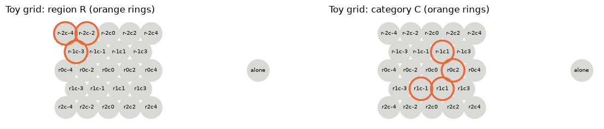
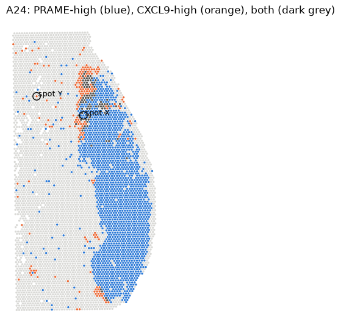

# Stage 2 · Benchmark: questions and reference answers

The first version of the natural-language benchmark (point 5 of Myles's week-2 instructions). It is the "exam" the
LLM will take later: simple spatial questions with known correct answers.

**Two rules keep it simple:**

1. **Every question is answered by one call of one of our three operations**, and the answer is read directly from
   its output. No extra steps (no medians, counts or filters), so the procedure is always clear.
2. **Every task is asked in two different wordings** with exactly the same operation and inputs (e.g. "within
   100 µm" / "at most 100 µm away"). Later this checks whether the LLM understands the meaning, not just the words.

The answers are computed with the **tested operations** (`src/space_mel/operations.py`), never by an LLM.

| Where | What |
|---|---|
| `02_spatial_operations/benchmark/benchmark.csv` | the 15 questions with all their fields and reference answers |
| `02_spatial_operations/notebooks/02_benchmark.ipynb` | the code that computes every answer (all outputs below come from it) |
| `02_spatial_operations/results/benchmark_*.png` | the two figures below |

## The three operations and the question each one answers

| Operation | What it returns | Question form |
|---|---|---|
| `spots_within_radius(spots, spot, r)` | the spots within *r* µm of one spot | which spots are near spot X? |
| `distance_to_region(spots, region)` | for every spot, the distance (µm) to the nearest region spot | how far is spot X from region Y? |
| `neighbourhood_fraction(spots, category, r)` | for every spot: neighbours, how many in the category, fraction | what share of spot X's neighbours are in Y? |

## What each question records

| Field | Meaning | Example (B07) |
|---|---|---|
| task | questions with the same task have the same procedure and answer | T4 |
| question | the question as a person would ask it | How far is spot GACGCTCGAGGAGTGC-1 from the nearest PRAME-high spot? |
| data | toy grid or patient | A24 |
| operation | the one function that answers it | `distance_to_region` |
| inputs | the spot and the region / category | spot GACGCTCGAGGAGTGC-1; region PRAME-high |
| parameters | radius and units | µm |
| assumptions | what the sets are based on | PRAME-high = PRAME > 1.5 |
| status | answered / awaiting annotation | answered |
| reference_answer | the correct answer, computed by code | 265.3 µm |

## The 15 questions

| ID | Task | Question | Operation | Reference answer |
|---|---|---|---|---|
| B01 | T1 | Which spots are within 100 µm of spot r0c0? | `spots_within_radius` | 6 spots: r-1c-1, r-1c1, r0c-2, r0c2, r1c-1, r1c1 |
| B02 | T1 | List the neighbours of spot r0c0 that are at most 100 µm away. | `spots_within_radius` | same as B01 |
| B03 | T2 | Which spots touch spot AACTGCCGCTACATCT-1? | `spots_within_radius` | 6 spots (listed below) |
| B04 | T2 | Which spots are directly next to spot AACTGCCGCTACATCT-1? | `spots_within_radius` | same as B03 |
| B05 | T3 | How far is spot r-2c2 from region R? | `distance_to_region` | 200.0 µm |
| B06 | T3 | What is the distance between spot r-2c2 and the closest spot of region R? | `distance_to_region` | 200.0 µm |
| B07 | T4 | How far is spot GACGCTCGAGGAGTGC-1 from the nearest PRAME-high spot? | `distance_to_region` | 265.3 µm |
| B08 | T4 | What is the distance from spot GACGCTCGAGGAGTGC-1 to the PRAME-high spots? | `distance_to_region` | 265.3 µm |
| B09 | T5 | What fraction of the neighbours of spot r0c0 (within 100 µm) are in category C? | `neighbourhood_fraction` | 4/6 = 0.67 |
| B10 | T5 | Of the spots within 100 µm of r0c0, what share belongs to category C? | `neighbourhood_fraction` | 4/6 = 0.67 |
| B11 | T6 | What fraction of the spots touching spot AACTGCCGCTACATCT-1 are CXCL9-high? | `neighbourhood_fraction` | 1/6 = 0.17 |
| B12 | T6 | Among the direct neighbours of spot AACTGCCGCTACATCT-1, what proportion is CXCL9-high? | `neighbourhood_fraction` | 1/6 = 0.17 |
| B13 | T7 | Which spots are within 100 µm of spot 'alone'? | `spots_within_radius` | none (empty list) |
| B14 | T8 | How far is spot s1 (section A22) from region {s2} (section A24)? | `distance_to_region` | not defined (NaN) |
| B15 | T9 | How far is spot GACGCTCGAGGAGTGC-1 from the nevus? | `distance_to_region` | **awaiting annotation** |

- **9 tasks, 15 questions:** 5 use `spots_within_radius`, 6 `distance_to_region`, 4 `neighbourhood_fraction`.
- **14 answered** (8 on the toy grid, 6 on A24), **1 awaiting annotation** (B15 needs a nevus label per spot).
- B13 and B14 are the **edge cases**: an isolated spot (the correct answer is "no spots") and two spots in
  different tissue sections (the correct answer is "no distance").
- "Signature enrichment" (is a gene higher near X?) is **not** included: it is not one of our operations yet.

## The data

**Toy grid:** a small drawn piece of the Visium grid (spots 100 µm apart) plus one isolated spot. Answers can be
checked by eye. Region **R** and category **C** are the orange rings.



**A24:** the real patient (filtered spots), with two sets each defined by **one gene** (expression only; no claim
that they are tumour or immune cells): **PRAME-high** = PRAME > 1.5 (1,888 spots) and **CXCL9-high** = CXCL9 > 2
(281 spots). Spot X and spot Y are the two spots the questions ask about.



"Touching" / "directly next to" = within **150 µm** (between the first and second ring of the grid; with real
coordinates, 100 µm misses neighbours, see guide 01).

## How each answer is computed

Each block is the code from the notebook, followed by the output it gave. Setup (in the notebook): `toy` and `spots`
are the spots tables of the toy grid and A24; `R`, `C`, `prame_high`, `cxcl9_high` are True/False per spot;
`X = "AACTGCCGCTACATCT-1"`, `Y = "GACGCTCGAGGAGTGC-1"`, `TOUCHING_UM = 150`.

### `spots_within_radius`

**T1** (B01, B02) · spots within 100 µm of r0c0 (toy)
```python
spots_within_radius(toy, "r0c0", 100)
```
```
['r-1c-1', 'r-1c1', 'r0c-2', 'r0c2', 'r1c-1', 'r1c1']
```

**T2** (B03, B04) · spots touching spot X (A24)
```python
spots_within_radius(spots, X, TOUCHING_UM)
```
```
['ATGTTCACTGCAATCC-1', 'CCGCTCGGTCACAGTC-1', 'CGGTAGCAGTCATACT-1',
 'CGTGGCGATTGCCACT-1', 'GCAGGTCAATAGCGAC-1', 'GGCGTGAGGAGCCGAA-1']
```

**T7** (B13) · spots within 100 µm of the isolated spot (toy)
```python
spots_within_radius(toy, "alone", 100)
```
```
[]
```

### `distance_to_region`

The operation returns a distance for **every** spot; the answer is the value of the spot the question asks about.

**T3** (B05, B06) · distance from r-2c2 to region R (toy)
```python
distance_to_region(toy, R)["r-2c2"]
```
```
200.0
```
Check in the figure: r-2c2 is in the top row, and the nearest R spot (r-2c-2) is two spots to its left in the same
row. Each step is 100 µm, so 2 × 100 = 200 µm.

**T4** (B07, B08) · distance from spot Y to the nearest PRAME-high spot (A24)
```python
distance_to_region(spots, prame_high)[Y]
```
```
265.3
```
Spot Y is in the dermis; its nearest PRAME-high spot is one of the scattered PRAME-high spots there, not the main
PRAME-high area. That is exactly what the question asks ("the nearest PRAME-high spot").

**T8** (B14) · two spots 10 µm apart but in different sections
```python
two = pd.DataFrame({"x_um": [0.0, 10.0], "y_um": [0.0, 0.0], "section": ["A22", "A24"]}, index=["s1", "s2"])
distance_to_region(two, pd.Series([False, True], index=two.index))["s1"]
```
```
nan
```

### `neighbourhood_fraction`

Returns, for every spot, the number of neighbours, how many are in the category and the fraction; the answer is the
row of the spot the question asks about.

**T5** (B09, B10) · share of r0c0's neighbours (within 100 µm) in category C (toy)
```python
neighbourhood_fraction(toy, C, 100).loc["r0c0"]
```
```
n_neighbours     6.000000
n_in_category    4.000000
fraction         0.666667
```

**T6** (B11, B12) · share of the spots touching X that are CXCL9-high (A24)
```python
neighbourhood_fraction(spots, cxcl9_high, TOUCHING_UM).loc[X]
```
```
n_neighbours     6.000000
n_in_category    1.000000
fraction         0.166667
```

## How the answers were checked

A reference answer is only useful if it is right, so every answer was checked a second, independent way.

**Toy grid (T1, T3, T5, T7, T8): checked mathematically, without code.** The toy grid is small and regular
(each step between touching spots is 100 µm), so the answers can be worked out easily by counting spots:

- T1: r0c0 has 6 touching spots, each one step (100 µm) away, so with "within 100 µm" all 6 count.
- T3: from r-2c2, the nearest R spot is two steps to the left in the same row: 2 × 100 = 200 µm.
- T5: count the orange rings around r0c0 in the right figure: 4 of its 6 touching spots.
- T7: the isolated spot is far from every other spot (3 steps), so nothing is within 100 µm.
- T8: the rule says spots in different sections never connect, so there is no distance.

The same cases are also in the automatic tests (`tests/test_operations.py`).

**A24 (T2, T4, T6): checked with a second, simpler piece of code.** A24 has 6,059 spots, too many to check on
paper. So the answers were recomputed in the slowest, most obvious way, **without using our operations**: measure the
straight-line distance from the spot to every other spot, one by one, with Pythagoras (√(Δx² + Δy²)), and read the
answer from that list ("brute force" means exactly this: check every possibility, no shortcuts).

Our operations get the same answers differently: they use a fast search method that avoids measuring every pair, plus
the project rules (boundary, the spot itself, sections). If two independent methods give the same answer, a mistake
would have to be in both of them at once, which is very unlikely.

The check is the last part of the notebook:

```python
def distances_from(spot):
    """Distance (µm) from one spot to every spot, with Pythagoras."""
    dx, dy = xy[:, 0] - spots.at[spot, "x_um"], xy[:, 1] - spots.at[spot, "y_um"]
    return pd.Series(np.sqrt(dx**2 + dy**2), index=spots.index)

d_x = distances_from(X).drop(X)               # spot X: distances to all other spots
touching = d_x[d_x <= TOUCHING_UM].index      # T2: the spots within 150 µm
d_y = distances_from(Y)[prame_high]           # spot Y: distances to the PRAME-high spots only
```
```
                                          operations  check  same?
T2: spots touching X                               6      6   True
T4: distance Y -> nearest PRAME-high (µm)      265.3  265.3   True
T6: CXCL9-high among X's touching spots          1/6    1/6   True
```

For T2 the check also confirms they are the **same 6 spots**, not just the same number.

## Caveats

- One patient (A24) and one threshold per gene: other thresholds give other answers. The benchmark tests the
  *calculation*, not biology.
- B15 needs a real nevus label; our only labels are expression thresholds, which can't stand in for "nevus".
- The questions are deliberately simple (one operation, one spot). Questions that combine operations or summarise
  many spots (e.g. "the median distance of all CXCL9-high spots") come later.
